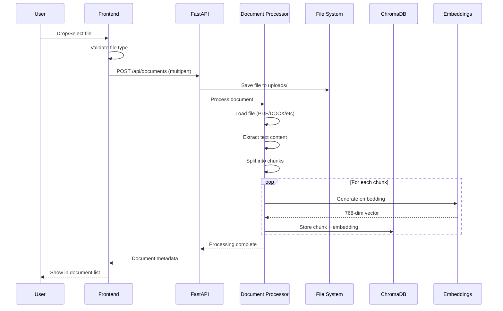
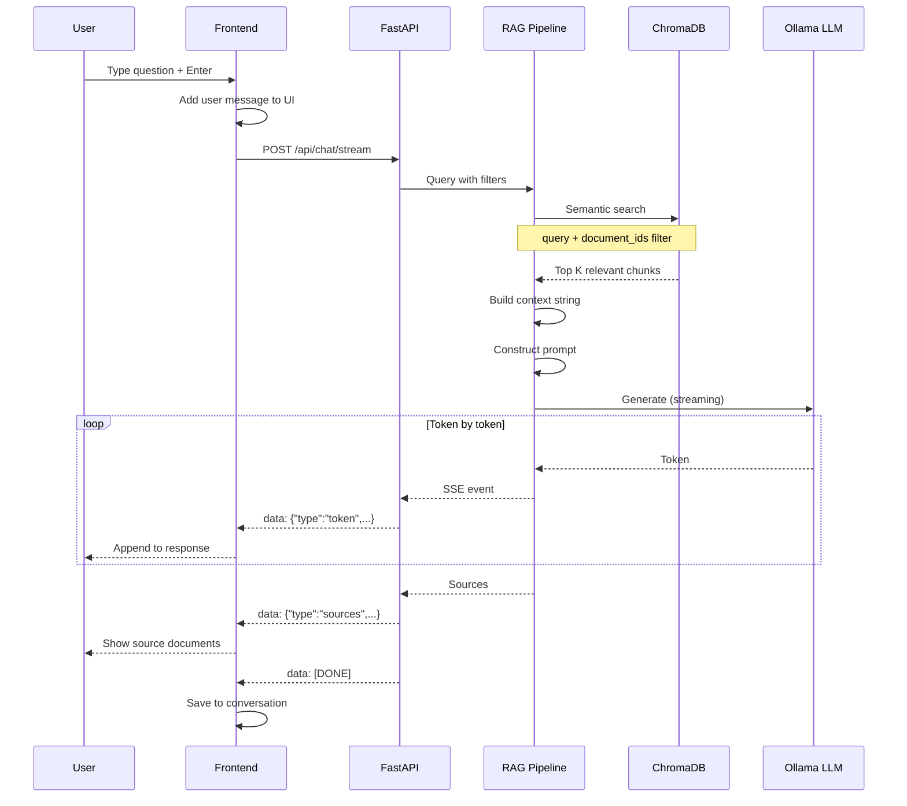
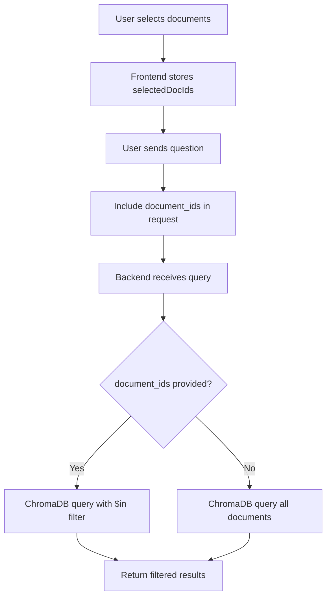
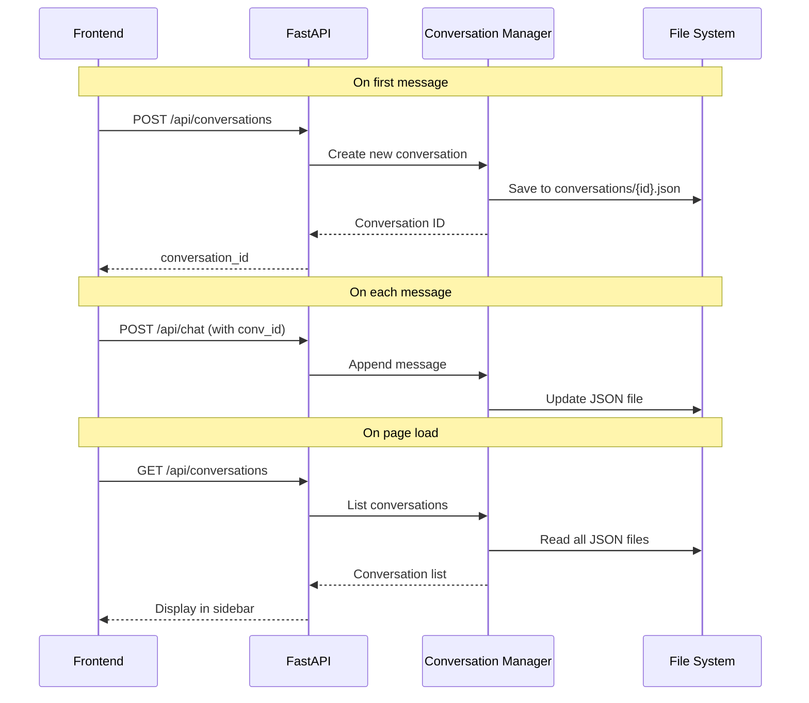
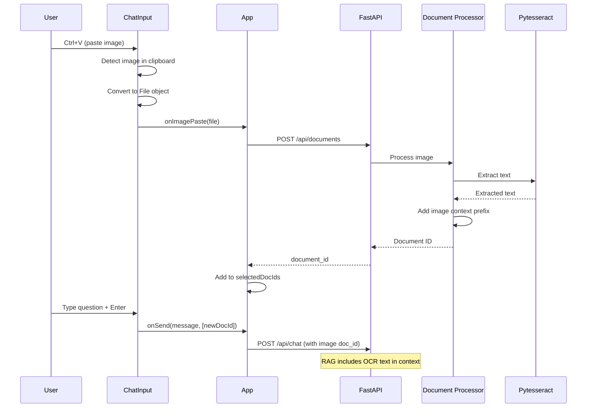
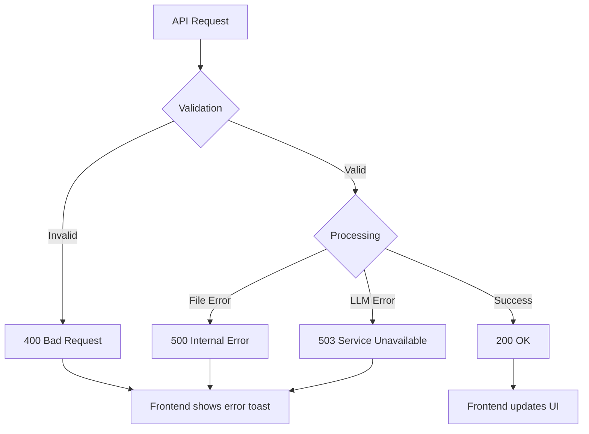

# Data Flow

This document describes how data flows through the RAG Document Q&A application for key operations.

---

## Document Upload Flow

When a user uploads a document, it goes through several processing stages before becoming searchable.



### Stage Details

#### 1. File Upload

```
Frontend → Backend
- HTTP POST multipart/form-data
- File size validation (default: 50MB max)
- File type validation (extension check)
```

#### 2. File Storage

```
Backend
- Generate UUID for document
- Save to: data/uploads/{uuid}.{ext}
- Store original filename in metadata
```

#### 3. Text Extraction

```
Document Processor
- PDF: PyPDF extracts page by page
- DOCX: python-docx extracts paragraphs
- Images: pytesseract OCR
- Excel: openpyxl extracts cell values
```

#### 4. Chunking

```
Text Splitter (RecursiveCharacterTextSplitter)
- chunk_size: 1000 characters
- chunk_overlap: 200 characters
- Preserves sentence boundaries when possible
```

#### 5. Embedding & Storage

```
ChromaDB
- Embedding model: nomic-embed-text
- Vector dimensions: 768
- Metadata: document_id, filename, chunk_index
```

---

## Chat Query Flow

When a user sends a question, RAG retrieves relevant context and generates a response.



### Query Processing Details

#### 1. Semantic Search

```python
# ChromaDB query with filtering
results = collection.query(
    query_texts=[user_question],
    n_results=4,  # Top 4 chunks
    where={"document_id": {"$in": selected_doc_ids}}  # Optional filter
)
```

#### 2. Context Building

```python
context = "\n\n---\n\n".join([
    f"Source: {doc.metadata['filename']}\n{doc.page_content}"
    for doc in retrieved_docs
])
```

#### 3. Prompt Construction

```python
prompt = f"""Use the following context to answer the question.
If you cannot answer based on the context, say so.

Context:
{context}

Question: {user_question}

Answer:"""
```

#### 4. Streaming Response

```python
async for chunk in llm.astream(prompt):
    yield {"type": "token", "content": chunk}
```

---

## Document Filtering Flow

When users select specific documents, queries are filtered to only those documents.



### Filter Implementation

```typescript
// Frontend: Track selected documents
const [selectedDocIds, setSelectedDocIds] = useState<Set<string>>(new Set());

// Include in API call
const response = await api.chat(
  message,
  conversationId,
  selectedDocIds.size > 0 ? Array.from(selectedDocIds) : undefined,
);
```

```python
# Backend: Apply filter
if document_ids:
    filter_dict = {"document_id": {"$in": document_ids}}
else:
    filter_dict = None

results = self.vectorstore.similarity_search(
    query,
    k=4,
    filter=filter_dict
)
```

---

## Conversation Persistence Flow

Conversations are automatically saved and can be resumed across sessions.



### Conversation Structure

```json
{
  "id": "conv_a1b2c3d4",
  "title": "Questions about RAG",
  "created_at": "2024-01-18T10:00:00Z",
  "updated_at": "2024-01-18T10:05:00Z",
  "messages": [
    {
      "id": "msg_1",
      "role": "user",
      "content": "What is RAG?",
      "timestamp": "2024-01-18T10:00:00Z"
    },
    {
      "id": "msg_2",
      "role": "assistant",
      "content": "RAG (Retrieval-Augmented Generation) is...",
      "timestamp": "2024-01-18T10:00:05Z",
      "sources": [{ "filename": "rag_intro.pdf", "content": "..." }]
    }
  ]
}
```

---

## Image Paste Flow (with OCR)

When a user pastes an image, it's processed with OCR and immediately included in the query.



### OCR Text Format

```
[The following text was extracted from an image file named 'screenshot.png'
using OCR (Optical Character Recognition). This is the visible text content
from that image:]

# RAG Document Q&A App
Build a full-stack application...
```

---

## Data Flow Summary

| Operation   | Frontend → Backend | Processing              | Storage               |
| ----------- | ------------------ | ----------------------- | --------------------- |
| Upload      | Multipart file     | Extract → Chunk → Embed | ChromaDB + Filesystem |
| Query       | JSON request       | Retrieve → Generate     | -                     |
| Stream      | SSE connection     | Token-by-token          | -                     |
| Filter      | document_ids array | $in filter              | -                     |
| Save Chat   | JSON request       | Append message          | JSON file             |
| Load Chats  | GET request        | Read files              | JSON files            |
| Paste Image | Multipart file     | OCR → Chunk → Embed     | ChromaDB + Filesystem |

---

## Error Handling Flow



```typescript
// Frontend error handling
try {
  const response = await api.uploadDocument(file);
  handleSuccess(response);
} catch (error) {
  if (error.response?.status === 400) {
    showToast("Invalid file type");
  } else if (error.response?.status === 503) {
    showToast("AI service unavailable");
  } else {
    showToast("Upload failed");
  }
}
```
