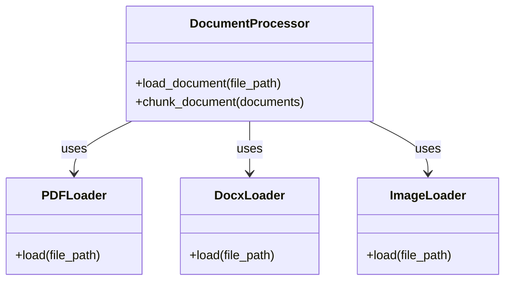
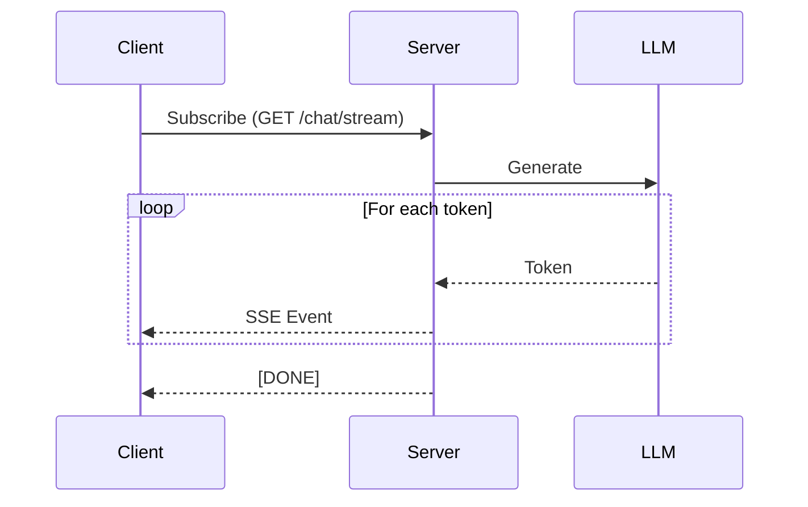
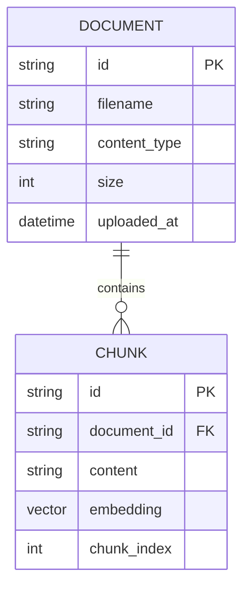

# Design Patterns

This document outlines the software design patterns employed throughout the RAG Document Q&A application.

---

## Backend Patterns

### 1. Repository Pattern

**Location:** `backend/app/core/`

The Repository Pattern abstracts data access, providing a clean interface between business logic and data storage.

```python
# document_store.py - Repository for document metadata
class DocumentStore:
    def __init__(self, storage_path: Path):
        self.storage_path = storage_path
        self._documents: Dict[str, DocumentMetadata] = {}

    def add(self, document: DocumentMetadata) -> None:
        """Add a document to the store."""
        self._documents[document.id] = document
        self._persist()

    def get(self, doc_id: str) -> Optional[DocumentMetadata]:
        """Retrieve a document by ID."""
        return self._documents.get(doc_id)

    def list_all(self) -> List[DocumentMetadata]:
        """List all documents."""
        return list(self._documents.values())

    def delete(self, doc_id: str) -> bool:
        """Delete a document."""
        if doc_id in self._documents:
            del self._documents[doc_id]
            self._persist()
            return True
        return False
```

**Benefits:**

- Decouples business logic from storage implementation
- Easy to swap storage backends (JSON → Database)
- Testable with mock repositories

---

### 2. Strategy Pattern

**Location:** `backend/app/core/document_processor.py`

The Strategy Pattern allows different document loading strategies based on file type.



```python
# Strategy selection based on file extension
def load_document(self, file_path: Path) -> list[Document]:
    ext = file_path.suffix.lower()

    # Strategy selection
    if ext == ".pdf":
        loader = PyPDFLoader(str(file_path))
    elif ext in {".docx", ".doc"}:
        return self._load_docx(file_path)
    elif ext in {".jpg", ".jpeg", ".png"}:
        return self._load_image(file_path)
    # ... more strategies

    return loader.load()
```

**Benefits:**

- Open/Closed Principle - Add new formats without modifying existing code
- Each loader is independently testable
- Clear separation of concerns

---

### 3. Chain of Responsibility

**Location:** `backend/app/core/rag.py`

The RAG pipeline uses Chain of Responsibility to process queries through multiple stages.


```python
# RAG Pipeline stages
class RAGPipeline:
    async def query(self, question: str, document_ids: List[str] = None):
        # Stage 1: Retrieve relevant documents
        context_docs = await self._retrieve(question, document_ids)

        # Stage 2: Build context
        context = self._build_context(context_docs)

        # Stage 3: Construct prompt
        prompt = self._build_prompt(question, context)

        # Stage 4: Generate response
        response = await self._generate(prompt)

        return response, context_docs
```

**Benefits:**

- Each stage is independently modifiable
- Easy to add/remove processing stages
- Clear data flow through the pipeline

---

### 4. Singleton Pattern

**Location:** `backend/app/core/rag.py`, `backend/app/core/document_processor.py`

Singleton ensures only one instance of expensive resources (LLM, embeddings, vector store).

```python
# Global singleton instances
_rag_pipeline: Optional[RAGPipeline] = None
_document_processor: Optional[DocumentProcessor] = None

def get_rag_pipeline() -> RAGPipeline:
    global _rag_pipeline
    if _rag_pipeline is None:
        _rag_pipeline = RAGPipeline()
    return _rag_pipeline
```

**Benefits:**

- Prevents multiple model loads (memory efficient)
- Shared state across requests
- Lazy initialization

---

### 5. Observer Pattern (Event Streaming)

**Location:** `backend/app/api/chat.py`

Server-Sent Events implement an Observer pattern for real-time streaming.



```python
# SSE Streaming implementation
async def generate_stream():
    async for chunk in rag_pipeline.stream(message):
        if chunk["type"] == "token":
            yield f"data: {json.dumps(chunk)}\n\n"
        elif chunk["type"] == "sources":
            yield f"data: {json.dumps(chunk)}\n\n"
    yield "data: [DONE]\n\n"

return StreamingResponse(
    generate_stream(),
    media_type="text/event-stream"
)
```

**Benefits:**

- Real-time updates without polling
- Efficient for long-running operations
- Standard HTTP (no WebSocket complexity)

---

## Frontend Patterns

### 1. Container/Presentational Pattern

**Location:** `frontend/src/App.tsx` + `frontend/src/components/`

Separates logic (containers) from UI (presentational components).

```
App.tsx (Container)
├── State management
├── API calls
├── Event handlers
└── Renders:
    ├── Sidebar.tsx (Presentational)
    ├── ChatMessage.tsx (Presentational)
    ├── ChatInput.tsx (Presentational)
    └── DocumentList.tsx (Presentational)
```

```tsx
// Container (App.tsx)
const App = () => {
  const [messages, setMessages] = useState<Message[]>([]);

  const handleSendMessage = async (content: string) => {
    // Logic here
  };

  return (
    <ChatInput onSend={handleSendMessage} />  // Presentational
  );
};

// Presentational (ChatInput.tsx)
interface ChatInputProps {
  onSend: (message: string) => void;
  disabled?: boolean;
}

const ChatInput: React.FC<ChatInputProps> = ({ onSend, disabled }) => {
  // Only UI logic, no business logic
  return <textarea ... />;
};
```

**Benefits:**

- Reusable presentational components
- Easier testing
- Clear separation of concerns

---

### 2. Compound Component Pattern

**Location:** `frontend/src/components/` (Modal, Sidebar)

Related components share implicit state through context.

```tsx
// Modal compound component
<Modal open={showModal} onClose={() => setShowModal(false)}>
  <Modal.Header>Confirm Delete</Modal.Header>
  <Modal.Body>Are you sure?</Modal.Body>
  <Modal.Footer>
    <Button onClick={handleCancel}>Cancel</Button>
    <Button onClick={handleConfirm}>Delete</Button>
  </Modal.Footer>
</Modal>
```

**Benefits:**

- Flexible composition
- Consistent styling
- Encapsulated state sharing

---

### 3. Custom Hooks Pattern

**Location:** Throughout frontend components

Reusable logic extracted into custom hooks.

```tsx
// Example: useStreamingResponse hook
const useStreamingResponse = (url: string) => {
  const [content, setContent] = useState("");
  const [isStreaming, setIsStreaming] = useState(false);

  const startStream = async (message: string) => {
    setIsStreaming(true);
    const eventSource = new EventSource(`${url}?message=${message}`);

    eventSource.onmessage = (event) => {
      if (event.data === "[DONE]") {
        setIsStreaming(false);
        eventSource.close();
      } else {
        const data = JSON.parse(event.data);
        setContent((prev) => prev + data.token);
      }
    };
  };

  return { content, isStreaming, startStream };
};
```

**Benefits:**

- Logic reuse across components
- Testable in isolation
- Clean component code

---

### 4. Optimistic Updates

**Location:** Message sending, document deletion

Update UI immediately, rollback on error.

```tsx
const handleSendMessage = async (content: string) => {
  // Optimistic: Add message immediately
  const userMessage = { id: Date.now(), role: "user", content };
  setMessages((prev) => [...prev, userMessage]);

  try {
    const response = await api.chat(content);
    // Success: Add response
    setMessages((prev) => [...prev, response]);
  } catch (error) {
    // Rollback: Remove optimistic message
    setMessages((prev) => prev.filter((m) => m.id !== userMessage.id));
    showError("Failed to send message");
  }
};
```

**Benefits:**

- Instant UI feedback
- Better perceived performance
- Graceful error handling

---

## Data Patterns

### 1. Event Sourcing (Conversations)

Conversations are stored as a sequence of events (messages).

```json
{
  "id": "conv_123",
  "title": "RAG Questions",
  "messages": [
    {
      "timestamp": "2024-01-18T10:00:00Z",
      "role": "user",
      "content": "What is RAG?"
    },
    {
      "timestamp": "2024-01-18T10:00:05Z",
      "role": "assistant",
      "content": "RAG stands for..."
    }
  ]
}
```

**Benefits:**

- Complete history preserved
- Easy to replay/audit
- Natural for chat applications

---

### 2. Document-Chunk Relationship

Documents are split into chunks with metadata linking back to the source.



**Benefits:**

- Efficient retrieval (chunks)
- Source attribution (document link)
- Granular filtering

---

## Pattern Summary

| Pattern                  | Location           | Purpose                 |
| ------------------------ | ------------------ | ----------------------- |
| Repository               | Backend/core       | Abstract data access    |
| Strategy                 | Document Processor | File type handling      |
| Chain of Responsibility  | RAG Pipeline       | Query processing stages |
| Singleton                | Core services      | Resource management     |
| Observer (SSE)           | Chat streaming     | Real-time updates       |
| Container/Presentational | Frontend           | UI/logic separation     |
| Compound Components      | Modals, Sidebar    | Component composition   |
| Custom Hooks             | Frontend           | Logic reuse             |
| Optimistic Updates       | UI actions         | Perceived performance   |
| Event Sourcing           | Conversations      | History preservation    |
