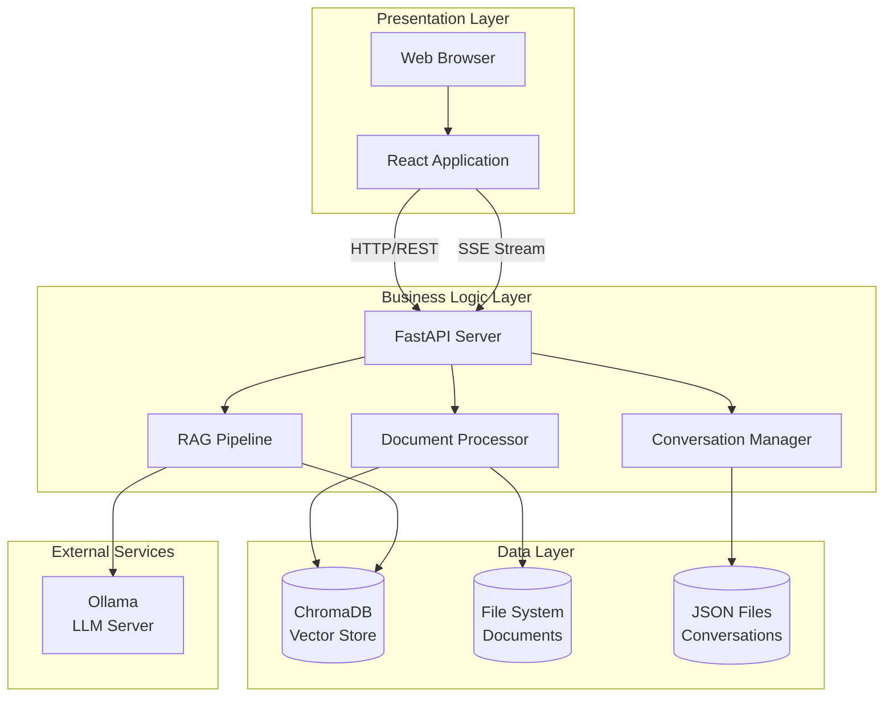
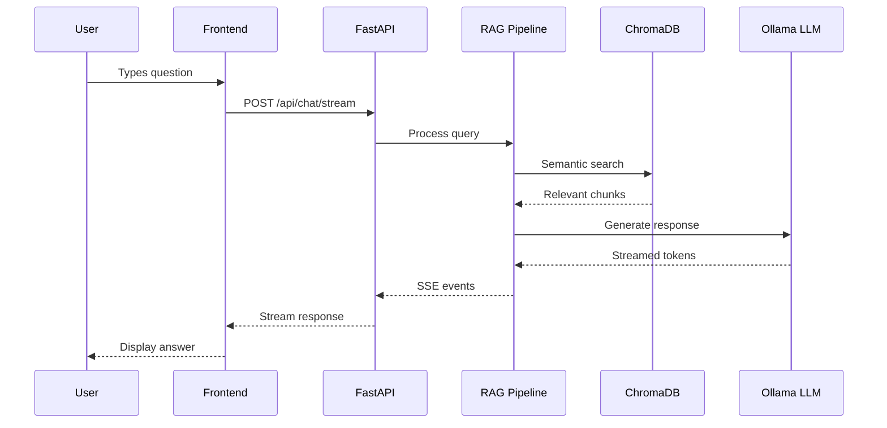

# Architecture Overview

The RAG Document Q&A application follows a **three-tier architecture** with clear separation of concerns between the presentation layer (frontend), business logic layer (backend), and data layer (storage).

## High-Level Architecture



## Component Responsibilities

### Presentation Layer

| Component      | Responsibility                                         |
| -------------- | ------------------------------------------------------ |
| **React App**  | User interface, state management, API communication    |
| **Components** | Reusable UI elements (ChatMessage, DocumentList, etc.) |
| **API Client** | HTTP client for backend communication                  |

### Business Logic Layer

| Component                | Responsibility                                         |
| ------------------------ | ------------------------------------------------------ |
| **FastAPI Server**       | HTTP endpoints, request validation, CORS handling      |
| **Document Processor**   | File parsing, text extraction, chunking, embedding     |
| **RAG Pipeline**         | Query processing, context retrieval, LLM orchestration |
| **Conversation Manager** | Chat history persistence, context management           |

### Data Layer

| Store                  | Purpose                              | Technology       |
| ---------------------- | ------------------------------------ | ---------------- |
| **Vector Store**       | Semantic search over document chunks | ChromaDB         |
| **File System**        | Original document storage            | Local filesystem |
| **Conversation Store** | Chat history persistence             | JSON files       |

## Design Principles

### 1. Separation of Concerns

Each layer has distinct responsibilities and communicates through well-defined interfaces.

### 2. Stateless API Design

The backend API is stateless - all state is stored in the data layer, enabling horizontal scaling.

### 3. Async-First

Both frontend and backend use async patterns for non-blocking I/O operations.

### 4. Local-First AI

Uses Ollama for local LLM inference, ensuring data privacy and eliminating API costs.

## Request Flow Example



## Directory Structure

```
rag-research/
├── backend/
│   ├── app/
│   │   ├── api/           # API endpoints
│   │   ├── core/          # Business logic
│   │   ├── models/        # Pydantic schemas
│   │   └── main.py        # FastAPI app
│   ├── data/
│   │   ├── chroma/        # Vector database
│   │   ├── uploads/       # Uploaded files
│   │   └── conversations/ # Chat history
│   └── requirements.txt
│
├── frontend/
│   ├── src/
│   │   ├── components/    # React components
│   │   ├── services/      # API client
│   │   ├── types/         # TypeScript types
│   │   └── App.tsx        # Main component
│   └── package.json
│
└── docs/                  # This documentation
```

## Next Steps

- [Tech Stack](tech-stack.md) - Detailed technology choices and rationale
- [Design Patterns](design-patterns.md) - Patterns used throughout the codebase
- [Data Flow](data-flow.md) - How data moves through the system
