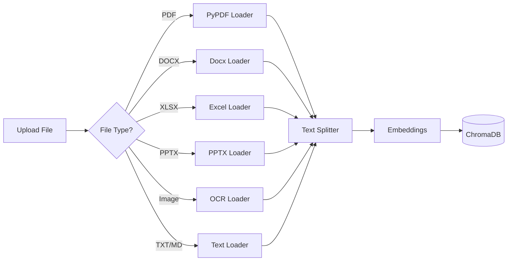

# Tech Stack

A detailed breakdown of all technologies used in the RAG Document Q&A application.

## Overview Table

| Layer                   | Technology       | Version | Purpose                  |
| ----------------------- | ---------------- | ------- | ------------------------ |
| **Frontend**            | React            | 18.x    | UI library               |
|                         | TypeScript       | 5.x     | Type safety              |
|                         | Vite             | 5.x     | Build tool & dev server  |
|                         | Tailwind CSS     | 3.x     | Styling                  |
| **Backend**             | Python           | 3.9+    | Runtime                  |
|                         | FastAPI          | 0.100+  | Web framework            |
|                         | LangChain        | 0.1+    | RAG framework            |
|                         | Pydantic         | 2.x     | Data validation          |
| **AI/ML**               | Ollama           | Latest  | Local LLM server         |
|                         | llama3.2         | 3.2     | Language model           |
|                         | nomic-embed-text | Latest  | Embeddings model         |
| **Storage**             | ChromaDB         | 0.4+    | Vector database          |
|                         | JSON             | -       | Conversation persistence |
| **Document Processing** | PyPDF            | 0.4+    | PDF extraction           |
|                         | python-docx      | 0.8+    | Word documents           |
|                         | openpyxl         | 3.1+    | Excel files              |
|                         | python-pptx      | 0.6+    | PowerPoint files         |
|                         | pytesseract      | 0.3+    | Image OCR                |

---

## Frontend Stack

### React 18

React is chosen for its:

- **Component-based architecture** - Reusable UI components
- **Virtual DOM** - Efficient rendering
- **Large ecosystem** - Rich library support
- **Hooks API** - Clean state management

```typescript
// Example: Using React hooks for state
const [messages, setMessages] = useState<Message[]>([]);
const [isStreaming, setIsStreaming] = useState(false);
```

### TypeScript

TypeScript provides:

- **Type safety** - Catch errors at compile time
- **IntelliSense** - Better IDE support
- **Self-documenting code** - Types serve as documentation

```typescript
// Example: Type definitions
interface Message {
  id: string;
  role: "user" | "assistant";
  content: string;
  timestamp: Date;
  sources?: SourceDocument[];
}
```

### Vite

Vite is selected for:

- **Fast HMR** - Instant hot module replacement
- **ES modules** - Modern JavaScript support
- **Optimized builds** - Efficient production bundles

### Tailwind CSS

Tailwind provides:

- **Utility-first** - Rapid UI development
- **No context switching** - Style in markup
- **Responsive design** - Built-in breakpoints
- **Dark mode** - Easy theme support

```tsx
// Example: Tailwind classes
<button
  className="px-4 py-2 bg-blue-600 hover:bg-blue-700 
                   text-white rounded-lg transition-colors"
>
  Send Message
</button>
```

---

## Backend Stack

### FastAPI

FastAPI is chosen for:

- **High performance** - One of the fastest Python frameworks
- **Async support** - Native async/await
- **Auto documentation** - OpenAPI/Swagger UI
- **Type hints** - Pydantic integration

```python
# Example: FastAPI endpoint
@router.post("/chat/stream")
async def chat_stream(request: ChatRequest):
    async def generate():
        async for chunk in rag_pipeline.stream(request.message):
            yield f"data: {json.dumps(chunk)}\n\n"
    return StreamingResponse(generate(), media_type="text/event-stream")
```

### LangChain

LangChain provides:

- **Document loaders** - Multi-format support
- **Text splitters** - Intelligent chunking
- **Vector stores** - ChromaDB integration
- **Chains** - Composable RAG pipelines

```python
# Example: LangChain RAG chain
from langchain.chains import RetrievalQA
from langchain_community.vectorstores import Chroma

chain = RetrievalQA.from_chain_type(
    llm=llm,
    retriever=vectorstore.as_retriever(),
    return_source_documents=True
)
```

### Pydantic

Pydantic provides:

- **Data validation** - Automatic request/response validation
- **Serialization** - JSON encoding/decoding
- **Settings management** - Environment configuration

```python
# Example: Pydantic model
class ChatRequest(BaseModel):
    message: str
    conversation_id: Optional[str] = None
    document_ids: Optional[List[str]] = None
```

---

## AI/ML Stack

### Ollama

Ollama enables:

- **Local inference** - No API costs or data sharing
- **Easy model management** - Pull models with one command
- **Multiple models** - Switch between models easily

```bash
# Install and run models
ollama pull llama3.2
ollama pull nomic-embed-text
```

### llama3.2 (LLM)

Meta's Llama 3.2 provides:

- **Strong reasoning** - High-quality responses
- **Context window** - 8K token context
- **Instruction following** - Good at following prompts

### nomic-embed-text (Embeddings)

Nomic embeddings offer:

- **768 dimensions** - Rich semantic representation
- **Fast inference** - Quick embedding generation
- **Open source** - No API costs

---

## Storage Stack

### ChromaDB

ChromaDB is selected for:

- **Embedded database** - No separate server needed
- **Persistent storage** - Data survives restarts
- **Metadata filtering** - Filter by document ID, type, etc.
- **LangChain integration** - Native support

```python
# Example: ChromaDB with filtering
results = collection.query(
    query_texts=["What is RAG?"],
    n_results=4,
    where={"document_id": {"$in": ["doc1", "doc2"]}}
)
```

### JSON File Storage

JSON is used for conversations because:

- **Simple** - No database setup needed
- **Human readable** - Easy debugging
- **Portable** - Easy backup/restore

```json
{
  "id": "conv_123",
  "title": "RAG Questions",
  "messages": [
    { "role": "user", "content": "What is RAG?" },
    { "role": "assistant", "content": "RAG stands for..." }
  ]
}
```

---

## Document Processing Stack

### Supported Formats

| Format   | Library              | Features                      |
| -------- | -------------------- | ----------------------------- |
| PDF      | PyPDF                | Text extraction, page-by-page |
| DOCX     | python-docx          | Paragraphs, tables, headers   |
| XLSX/XLS | openpyxl             | Sheets, cells, formulas       |
| PPTX/PPT | python-pptx          | Slides, text boxes, notes     |
| Images   | pytesseract + Pillow | OCR text extraction           |
| TXT/MD   | Built-in             | Plain text, Markdown          |

### Processing Pipeline



---

## Why These Choices?

### Local-First Philosophy

All AI processing happens locally:

- ✅ **Privacy** - Documents never leave your machine
- ✅ **No costs** - No API fees
- ✅ **Offline capable** - Works without internet
- ✅ **Fast** - No network latency for inference

### Developer Experience

Prioritized DX with:

- ✅ **Hot reload** - Instant feedback during development
- ✅ **Type safety** - Catch errors early
- ✅ **Auto-docs** - FastAPI generates OpenAPI specs
- ✅ **Modern tooling** - Vite, TypeScript, Tailwind

### Production Ready

MVP designed with production in mind:

- ✅ **Async** - Non-blocking I/O throughout
- ✅ **Streaming** - Real-time response delivery
- ✅ **Persistence** - Data survives restarts
- ✅ **Modular** - Easy to extend or replace components
