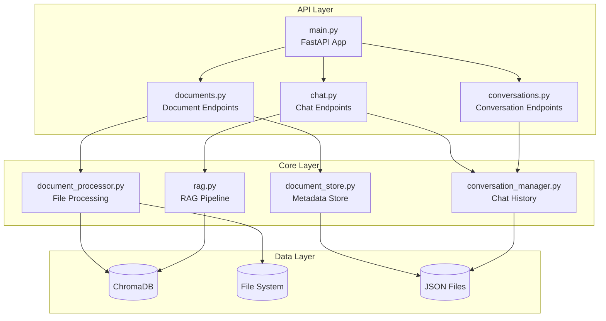

# Backend Overview

The backend is built with **FastAPI** and provides a REST API for document management and AI-powered question answering.

## Architecture



## Directory Structure

```
backend/
├── app/
│   ├── __init__.py
│   ├── main.py              # FastAPI application entry point
│   ├── api/
│   │   ├── __init__.py
│   │   ├── documents.py     # Document upload/list/delete endpoints
│   │   ├── chat.py          # Chat and streaming endpoints
│   │   └── conversations.py # Conversation CRUD endpoints
│   ├── core/
│   │   ├── __init__.py
│   │   ├── document_processor.py  # Document loading & chunking
│   │   ├── document_store.py      # Document metadata storage
│   │   ├── rag.py                 # RAG pipeline implementation
│   │   └── conversation_manager.py # Chat history management
│   └── models/
│       ├── __init__.py
│       └── schemas.py       # Pydantic models
├── data/
│   ├── chroma/              # ChromaDB persistent storage
│   ├── uploads/             # Uploaded document files
│   └── conversations/       # Chat history JSON files
├── requirements.txt
└── .env                     # Environment configuration
```

## Key Components

### FastAPI Application (`main.py`)

The main entry point configures:

- CORS middleware for frontend communication
- API routers for different endpoints
- Static file serving for uploads
- Startup/shutdown events

```python
from fastapi import FastAPI
from fastapi.middleware.cors import CORSMiddleware

app = FastAPI(title="RAG Document Q&A API")

app.add_middleware(
    CORSMiddleware,
    allow_origins=["http://localhost:5173"],
    allow_credentials=True,
    allow_methods=["*"],
    allow_headers=["*"],
)

app.include_router(documents.router, prefix="/api")
app.include_router(chat.router, prefix="/api")
app.include_router(conversations.router, prefix="/api")
```

### Core Services

| Service                  | File                      | Responsibility                                      |
| ------------------------ | ------------------------- | --------------------------------------------------- |
| **Document Processor**   | `document_processor.py`   | Load files, extract text, chunk, embed              |
| **RAG Pipeline**         | `rag.py`                  | Query processing, context retrieval, LLM generation |
| **Document Store**       | `document_store.py`       | Document metadata CRUD                              |
| **Conversation Manager** | `conversation_manager.py` | Chat history persistence                            |

### Data Models (`schemas.py`)

Pydantic models for request/response validation:

```python
class ChatRequest(BaseModel):
    message: str
    conversation_id: Optional[str] = None
    document_ids: Optional[List[str]] = None

class ChatResponse(BaseModel):
    response: str
    sources: List[SourceDocument]
    conversation_id: str

class DocumentMetadata(BaseModel):
    id: str
    filename: str
    content_type: str
    size: int
    chunk_count: int
    uploaded_at: datetime
```

## Configuration

Environment variables (`.env`):

```bash
# LLM Configuration
OLLAMA_MODEL=llama3.2
EMBEDDING_MODEL=nomic-embed-text

# Storage Paths
CHROMA_PATH=./data/chroma
UPLOAD_PATH=./data/uploads
CONVERSATIONS_PATH=./data/conversations

# API Settings
MAX_FILE_SIZE=52428800  # 50MB
CHUNK_SIZE=1000
CHUNK_OVERLAP=200
```

## Running the Backend

```bash
cd backend

# Create virtual environment
uv venv
source .venv/bin/activate

# Install dependencies
uv pip install -r requirements.txt

# Start server
uvicorn app.main:app --reload --port 8000
```

The API will be available at `http://localhost:8000` with:

- Interactive docs: `http://localhost:8000/docs`
- ReDoc: `http://localhost:8000/redoc`

## Next Steps

- [Document Processing](document-processing.md) - How documents are processed
- [Vector Store](vector-store.md) - ChromaDB configuration and usage
- [RAG Pipeline](rag-pipeline.md) - Query processing and generation
