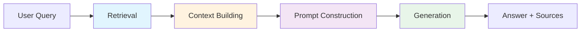
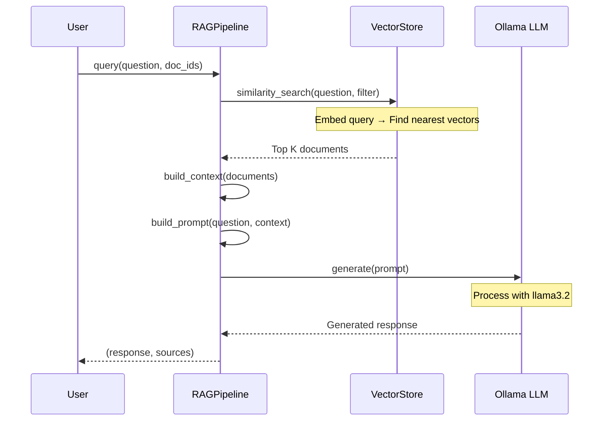

# RAG Pipeline

The RAG (Retrieval-Augmented Generation) pipeline combines document retrieval with LLM generation to answer questions based on your documents.

## Pipeline Overview



## Pipeline Stages

### 1. Retrieval

Find the most relevant document chunks for the user's question.

```python
def retrieve(
    self,
    query: str,
    document_ids: list[str] = None,
    k: int = 4
) -> list[Document]:
    """Retrieve relevant documents for a query."""

    if document_ids:
        # Filter to specific documents
        filter_dict = {"document_id": {"$in": document_ids}}
    else:
        filter_dict = None

    return self.vectorstore.similarity_search(
        query=query,
        k=k,
        filter=filter_dict
    )
```

### 2. Context Building

Combine retrieved chunks into a context string for the LLM.

```python
def build_context(self, documents: list[Document]) -> str:
    """Build context string from retrieved documents."""

    context_parts = []
    for doc in documents:
        source = doc.metadata.get("filename", "Unknown")
        content = doc.page_content
        context_parts.append(f"Source: {source}\n{content}")

    return "\n\n---\n\n".join(context_parts)
```

### 3. Prompt Construction

The system message is built in `app/core/tone.py` from three parts, in this order:

1. **Grounding rules**, the same for every tone: use only the context, say plainly
   when the context does not contain the answer, cite sources as `[Source n]`, and
   never invent facts, quotes, page numbers or file names.
2. **Style**, generated from the user's tone (see below).
3. **Context** (the retrieved chunks) and, when there is one, the **conversation so far**.

The user's question is sent as a separate human message. The system message is a
plain string, not a `{}` template, so nothing a user types can break it.

```python
messages = [
    SystemMessage(content=build_system_prompt(context, history, tone)),
    HumanMessage(content=question),
]
```

Context labels show a page only where it means something: `page 3` for PDFs
(pages are shown one-based) and `slide 7` for presentations. Text, Markdown and
Word files have no page.

#### Tone

Users choose how answers sound. The request carries an optional `tone`
(`POST /api/chat` and `/api/chat/stream`); without it the server uses `neutral`.
`GET /api/chat/tone` lists the presets and options.

| Field | Values | Default |
| ----- | ------ | ------- |
| `preset` | `neutral`, `concise`, `friendly`, `playful`, `sassy`, `custom` | `neutral` |
| `formality` | `casual`, `balanced`, `formal` | `balanced` |
| `length` | `brief`, `standard`, `detailed` | `standard` |
| `humor` | `none`, `light`, `lots` | `none` |
| `format` | `prose`, `bullets` | `prose` |
| `note` | free text, up to 300 characters | empty |

A preset other than `custom` fixes the other fields (and ignores the note), so
`concise` always means the same thing. The note is shown to the model inside a
delimited block, after the grounding rules, as a style preference only. Unknown
values or a longer note return a 422.

The tone also sets the sampling temperature: `llm_temperature` (0.3) for a plain
voice, more for humor, never above `llm_temperature_max` (0.8). Facts do not get
less reliable because the voice is playful. The tone is applied to the next
question; stored conversations do not record it.

### 4. Generation

Generate the response using the LLM.

```python
async def generate(self, prompt: str) -> str:
    """Generate response from LLM."""

    response = await self.llm.ainvoke(prompt)
    return response.content
```

## Streaming Implementation

For real-time response display, the pipeline supports token-by-token streaming.

```python
async def stream(
    self,
    query: str,
    document_ids: list[str] = None
) -> AsyncGenerator[dict, None]:
    """Stream response tokens and sources."""

    # Retrieve relevant documents
    docs = self.retrieve(query, document_ids)

    # Build context and prompt
    context = self.build_context(docs)
    prompt = self.build_prompt(query, context)

    # Stream tokens from LLM
    async for chunk in self.llm.astream(prompt):
        yield {
            "type": "token",
            "content": chunk.content
        }

    # Send sources at the end
    yield {
        "type": "sources",
        "sources": [
            {
                "filename": doc.metadata.get("filename"),
                "content": doc.page_content[:200] + "..."
            }
            for doc in docs
        ]
    }
```

## RAG Pipeline Class

```python
class RAGPipeline:
    def __init__(self):
        # Initialize LLM
        self.llm = ChatOllama(
            model="llama3.2",
            temperature=0.7,
        )

        # Initialize embeddings and vector store
        self.embeddings = OllamaEmbeddings(model="nomic-embed-text")
        self.vectorstore = Chroma(
            persist_directory="./data/chroma",
            embedding_function=self.embeddings,
            collection_name="documents"
        )

    async def query(
        self,
        question: str,
        document_ids: list[str] = None,
        conversation_history: list[dict] = None
    ) -> tuple[str, list[Document]]:
        """Execute full RAG pipeline."""

        # 1. Retrieve
        docs = self.retrieve(question, document_ids)

        # 2. Build context
        context = self.build_context(docs)

        # 3. Build prompt (with optional history)
        prompt = self.build_prompt(question, context, conversation_history)

        # 4. Generate
        response = await self.generate(prompt)

        return response, docs
```

## Conversation History

The pipeline supports multi-turn conversations by including history in the prompt.

```python
def build_prompt_with_history(
    self,
    query: str,
    context: str,
    history: list[dict]
) -> str:
    """Build prompt including conversation history."""

    history_text = ""
    if history:
        history_parts = []
        for msg in history[-6:]:  # Last 6 messages (3 turns)
            role = "Human" if msg["role"] == "user" else "Assistant"
            history_parts.append(f"{role}: {msg['content']}")
        history_text = "\n".join(history_parts)

    return f"""You are a helpful assistant that answers questions based on the provided context.

Context from documents:
{context}

{f"Conversation history:{chr(10)}{history_text}{chr(10)}{chr(10)}" if history_text else ""}Current question: {query}

Answer based on the context. If citing, mention the source."""
```

## LLM Configuration

### Ollama Settings

```python
from langchain_community.chat_models import ChatOllama

llm = ChatOllama(
    model="llama3.2",      # Model name
    temperature=0.3,       # Set per request from the tone (0.3 to 0.8)
    num_ctx=4096,          # Context window
    num_predict=1024,      # Max response tokens
)
```

### Temperature Guide

| Temperature | Use Case                       |
| ----------- | ------------------------------ |
| 0.0 - 0.3   | Factual, deterministic answers |
| 0.4 - 0.7   | Balanced, natural responses    |
| 0.8 - 1.0   | Creative, varied responses     |

## Retrieval Tuning

### Number of Chunks (k)

```python
# Default: 4 chunks
# Increase for complex questions needing more context
# Decrease for simple, focused questions

docs = vectorstore.similarity_search(query, k=4)
```

### Relevance Filtering

```python
# Use similarity_search_with_score for relevance filtering
results = vectorstore.similarity_search_with_score(query, k=10)

# Filter by relevance threshold
threshold = 0.7
relevant_docs = [doc for doc, score in results if score >= threshold]
```

## Error Handling

```python
async def query_safe(self, question: str) -> tuple[str, list]:
    """RAG query with error handling."""

    try:
        return await self.query(question)
    except Exception as e:
        logger.error(f"RAG pipeline error: {e}")

        # Return graceful fallback
        return (
            "I encountered an error processing your question. "
            "Please try again or rephrase your question.",
            []
        )
```

## Performance Metrics

```python
import time

async def query_with_metrics(self, question: str) -> dict:
    """Query with performance tracking."""

    metrics = {}

    # Retrieval timing
    start = time.time()
    docs = self.retrieve(question)
    metrics["retrieval_ms"] = (time.time() - start) * 1000

    # Generation timing
    start = time.time()
    context = self.build_context(docs)
    prompt = self.build_prompt(question, context)
    response = await self.generate(prompt)
    metrics["generation_ms"] = (time.time() - start) * 1000

    metrics["total_ms"] = metrics["retrieval_ms"] + metrics["generation_ms"]
    metrics["chunks_retrieved"] = len(docs)

    return {
        "response": response,
        "sources": docs,
        "metrics": metrics
    }
```

## Pipeline Diagram



## Best Practices

1. **Chunk Size**: Keep chunks small enough for relevance but large enough for context
2. **Overlap**: Use 10-20% overlap to maintain context across chunks
3. **K Value**: Start with k=4, adjust based on answer quality
4. **Temperature**: Use lower values (0.3-0.5) for factual Q&A
5. **Prompt Engineering**: Be explicit about using only the provided context
6. **History Limit**: Include only recent history to save context window space
