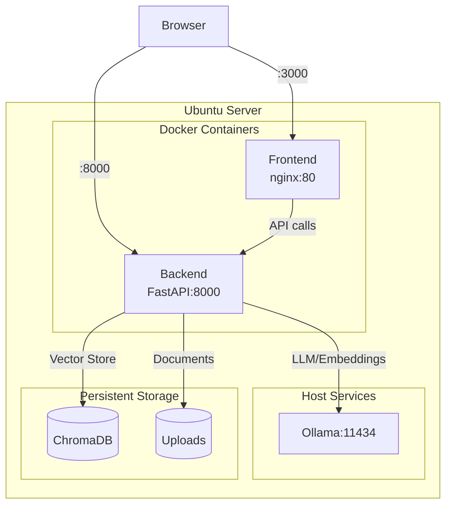
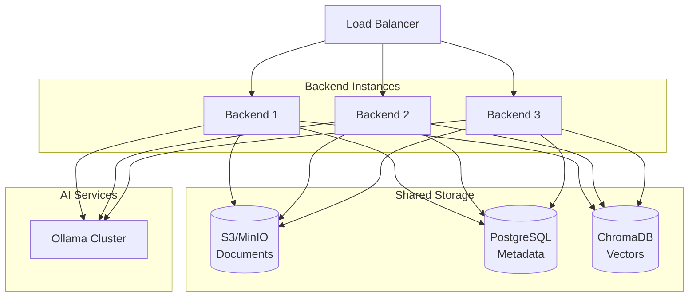

# Production Deployment

This guide covers deploying the RAG Document Q&A application to a homelab Ubuntu Server using Docker.

!!! warning "MVP Notice"
This application is an MVP designed for learning and demonstration purposes. Additional hardening is recommended for production use.

---

## Prerequisites

- **Ubuntu Server 22.04 LTS** (or newer)
- **Minimum 8GB RAM** (16GB recommended for better model performance)
- **50GB+ disk space** (for models and documents)
- **SSH access** to your server

## Architecture Overview



---

## Quick Start (Homelab)

### 1. Server Setup

Run the setup script to install Docker and Ollama:

```bash
# Download and run setup script
curl -O https://raw.githubusercontent.com/yourusername/rag-research/main/scripts/setup-ubuntu.sh
chmod +x setup-ubuntu.sh
sudo ./setup-ubuntu.sh
```

!!! info "What the setup script does" - Updates system packages - Installs Docker and Docker Compose - Installs Ollama - Pulls required models (`llama3.2`, `nomic-embed-text`) - Configures firewall (opens ports 22, 3000, 8000) - Creates `/opt/rag-qa` directory

### 2. Deploy Application

```bash
# Clone the repository
cd /opt/rag-qa
git clone https://github.com/yourusername/rag-research.git .

# Configure environment
cp .env.production .env

# Create data directories
mkdir -p data/chroma data/uploads

# Start the application
docker compose up -d
```

### 3. Access the Application

- **Frontend**: `http://<server-ip>:3000`
- **Backend API**: `http://<server-ip>:8000`
- **API Docs**: `http://<server-ip>:8000/docs`

---

## Deployment Options

| Option             | Pros                 | Cons                     | Best For            |
| ------------------ | -------------------- | ------------------------ | ------------------- |
| **Docker Compose** | Simple, reproducible | Single machine           | Homelab/Small teams |
| **Kubernetes**     | Scalable, HA         | Complex setup            | Enterprise          |
| **Cloud VMs**      | Full control         | Manual setup             | Custom needs        |
| **Serverless**     | Auto-scaling         | Cold starts, LLM latency | API-only            |

---

## Docker Deployment

### Dockerfile - Backend

```dockerfile
# backend/Dockerfile
FROM python:3.11-slim

WORKDIR /app

# Install system dependencies (including tesseract for OCR)
RUN apt-get update && apt-get install -y \
    tesseract-ocr \
    curl \
    && rm -rf /var/lib/apt/lists/*

# Install Python dependencies from pyproject.toml
COPY pyproject.toml .
RUN pip install --no-cache-dir .

# Copy application code
COPY app/ ./app/

# Create non-root user for security
RUN useradd --create-home --shell /bin/bash appuser \
    && mkdir -p data/uploads data/chroma data/conversations \
    && chown -R appuser:appuser /app
USER appuser

# Health check
HEALTHCHECK --interval=30s --timeout=10s --start-period=10s --retries=3 \
    CMD curl -f http://localhost:8000/health || exit 1

EXPOSE 8000

CMD ["uvicorn", "app.main:app", "--host", "0.0.0.0", "--port", "8000"]
```

### Dockerfile - Frontend

```dockerfile
# frontend/Dockerfile - Multi-stage build
FROM node:20-alpine AS builder

WORKDIR /app
COPY package*.json ./
RUN npm ci
COPY . .

# Build argument for API URL
ARG VITE_API_URL=http://localhost:8000
ENV VITE_API_URL=$VITE_API_URL
RUN npm run build

# Production stage
FROM nginx:alpine

COPY --from=builder /app/dist /usr/share/nginx/html
COPY nginx.conf /etc/nginx/conf.d/default.conf

# Health check
HEALTHCHECK --interval=30s --timeout=10s --start-period=5s --retries=3 \
    CMD wget -q --spider http://localhost/ || exit 1

EXPOSE 80
CMD ["nginx", "-g", "daemon off;"]
```

### Docker Compose

```yaml
# docker-compose.yml
services:
  backend:
    build: ./backend
    container_name: rag-backend
    restart: unless-stopped
    ports:
      - "8000:8000"
    environment:
      - OLLAMA_HOST=${OLLAMA_HOST:-http://host.docker.internal:11434}
      - LLM_MODEL=${LLM_MODEL:-llama3.2}
      - EMBEDDING_MODEL=${EMBEDDING_MODEL:-nomic-embed-text}
    volumes:
      - chroma_data:/app/data/chroma
      - uploads_data:/app/data/uploads
    extra_hosts:
      - "host.docker.internal:host-gateway"
    healthcheck:
      test: ["CMD", "curl", "-f", "http://localhost:8000/health"]
      interval: 30s
      timeout: 10s
      retries: 3

  frontend:
    build:
      context: ./frontend
      args:
        VITE_API_URL: ${VITE_API_URL:-http://localhost:8000}
    container_name: rag-frontend
    restart: unless-stopped
    ports:
      - "3000:80"
    depends_on:
      backend:
        condition: service_healthy

volumes:
  chroma_data:
  uploads_data:
```

!!! tip "Ollama on Host"
The configuration above runs Ollama directly on the host (not in Docker) for better GPU access and performance. The `host.docker.internal` allows containers to reach the host's Ollama instance.

### Run with Docker Compose

```bash
# Build and start
docker compose up -d

# View logs
docker compose logs -f

# Rebuild after changes
docker compose up -d --build

# Stop
docker compose down
```

---

## Auto-Start on Boot

Configure the application to start automatically when the server boots:

```bash
# Copy systemd service file
sudo cp scripts/rag-qa.service /etc/systemd/system/

# Reload systemd
sudo systemctl daemon-reload

# Enable auto-start
sudo systemctl enable rag-qa

# Start the service
sudo systemctl start rag-qa

# Check status
sudo systemctl status rag-qa
```

### Systemd Service File

```ini
# scripts/rag-qa.service
[Unit]
Description=RAG Document Q&A Application
After=docker.service ollama.service
Requires=docker.service
Wants=ollama.service

[Service]
Type=oneshot
RemainAfterExit=yes
WorkingDirectory=/opt/rag-qa
ExecStart=/usr/bin/docker compose up -d
ExecStop=/usr/bin/docker compose down
ExecStartPre=/bin/bash -c 'systemctl is-active --quiet ollama || systemctl start ollama'

[Install]
WantedBy=multi-user.target
```

---

## Environment Configuration

### Production Environment Variables

```bash
# .env.production

# Ollama Configuration
OLLAMA_HOST=http://host.docker.internal:11434
LLM_MODEL=llama3.2
EMBEDDING_MODEL=nomic-embed-text

# Frontend API URL (use your server's IP or domain)
VITE_API_URL=http://192.168.1.100:8000

# Data persistence path
DATA_PATH=./data
```

!!! warning "Important"
Set `VITE_API_URL` to your server's actual IP address or domain name for the frontend to communicate with the backend. This is baked in at build time.

### Frontend Nginx Configuration

```nginx
# frontend/nginx.conf
server {
    listen 80;
    server_name localhost;
    root /usr/share/nginx/html;
    index index.html;

    # Gzip compression
    gzip on;
    gzip_vary on;
    gzip_types text/plain text/css application/json application/javascript;

    # Security headers
    add_header X-Frame-Options "SAMEORIGIN" always;
    add_header X-Content-Type-Options "nosniff" always;

    # SPA routing - serve index.html for all routes
    location / {
        try_files $uri $uri/ /index.html;
    }

    # Cache static assets
    location ~* \.(js|css|png|jpg|jpeg|gif|ico|svg|woff|woff2)$ {
        expires 1y;
        add_header Cache-Control "public, immutable";
    }
}
```

---

## Data Backup & Restore

### Automated Backups

Set up daily backups with cron:

```bash
# Make backup script executable
chmod +x scripts/backup.sh

# Edit crontab
crontab -e

# Add daily backup at 2 AM
0 2 * * * /opt/rag-qa/scripts/backup.sh >> /var/log/rag-backup.log 2>&1
```

### Manual Backup

```bash
./scripts/backup.sh
```

Backups are stored in `data/backups/` with timestamps:

```
rag_backup_20240115_020000_chroma.tar.gz
rag_backup_20240115_020000_uploads.tar.gz
```

### Restore from Backup

```bash
# List available backups
./scripts/restore.sh

# Restore specific backup
./scripts/restore.sh 20240115_020000
```

!!! danger "Restore Warning"
Restoring will overwrite existing data. The script creates a safety backup before restoring.

---

## Security Considerations

### API Security

```python
# Add to backend/app/main.py

from fastapi import Security, HTTPException
from fastapi.security import APIKeyHeader

API_KEY_HEADER = APIKeyHeader(name="X-API-Key")

async def verify_api_key(api_key: str = Security(API_KEY_HEADER)):
    if api_key != os.getenv("API_KEY"):
        raise HTTPException(status_code=403, detail="Invalid API key")
    return api_key

# Apply to routes
@router.post("/documents")
async def upload_document(
    file: UploadFile,
    api_key: str = Depends(verify_api_key)
):
    ...
```

### HTTPS Setup

```yaml
# docker-compose.yml addition
services:
  traefik:
    image: traefik:v2.10
    command:
      - "--providers.docker=true"
      - "--entrypoints.web.address=:80"
      - "--entrypoints.websecure.address=:443"
      - "--certificatesresolvers.letsencrypt.acme.httpchallenge=true"
      - "--certificatesresolvers.letsencrypt.acme.email=you@email.com"
    ports:
      - "80:80"
      - "443:443"
    volumes:
      - /var/run/docker.sock:/var/run/docker.sock
      - ./letsencrypt:/letsencrypt
```

### Rate Limiting

```python
from slowapi import Limiter
from slowapi.util import get_remote_address

limiter = Limiter(key_func=get_remote_address)
app.state.limiter = limiter

@app.post("/api/chat")
@limiter.limit("10/minute")
async def chat(request: Request):
    ...
```

---

## Scaling Considerations

### Horizontal Scaling



### Replace Local Storage

For production scaling, replace local file storage:

| Component     | Local          | Production                |
| ------------- | -------------- | ------------------------- |
| Documents     | Filesystem     | S3/MinIO                  |
| Metadata      | JSON files     | PostgreSQL                |
| Vectors       | ChromaDB local | ChromaDB Cloud / Pinecone |
| Conversations | JSON files     | PostgreSQL                |

---

## Monitoring

### Health Checks

```python
# backend/app/api/health.py
from fastapi import APIRouter

router = APIRouter()

@router.get("/health")
async def health_check():
    checks = {
        "api": "healthy",
        "ollama": await check_ollama(),
        "chromadb": await check_chromadb(),
    }

    overall = "healthy" if all(v == "healthy" for v in checks.values()) else "unhealthy"

    return {"status": overall, "checks": checks}
```

### Logging

```python
import logging

logging.basicConfig(
    level=logging.INFO,
    format='%(asctime)s - %(name)s - %(levelname)s - %(message)s',
    handlers=[
        logging.StreamHandler(),
        logging.FileHandler('app.log')
    ]
)

logger = logging.getLogger(__name__)

@router.post("/chat")
async def chat(request: ChatRequest):
    logger.info(f"Chat request: {request.message[:50]}...")
    # ...
```

### Metrics (Optional)

```python
from prometheus_client import Counter, Histogram

CHAT_REQUESTS = Counter('chat_requests_total', 'Total chat requests')
CHAT_LATENCY = Histogram('chat_latency_seconds', 'Chat request latency')

@router.post("/chat")
async def chat(request: ChatRequest):
    CHAT_REQUESTS.inc()
    with CHAT_LATENCY.time():
        # Process chat
        ...
```

---

## Backup Strategy

### Data to Backup

| Data            | Location              | Frequency |
| --------------- | --------------------- | --------- |
| Uploaded files  | `data/uploads/`       | Daily     |
| Vector database | `data/chroma/`        | Daily     |
| Conversations   | `data/conversations/` | Daily     |
| Configuration   | `.env`                | On change |

### Backup Script

```bash
#!/bin/bash
# backup.sh

DATE=$(date +%Y%m%d)
BACKUP_DIR="/backups/rag-app"

mkdir -p $BACKUP_DIR

# Backup data directory
tar -czf $BACKUP_DIR/data_$DATE.tar.gz ./data/

# Upload to S3 (optional)
aws s3 cp $BACKUP_DIR/data_$DATE.tar.gz s3://your-bucket/backups/

# Cleanup old backups (keep 7 days)
find $BACKUP_DIR -name "*.tar.gz" -mtime +7 -delete
```

---

## Checklist

### Pre-Deployment

- [ ] Set strong API keys
- [ ] Configure HTTPS
- [ ] Set up monitoring
- [ ] Configure backups
- [ ] Test disaster recovery
- [ ] Load testing completed
- [ ] Security audit completed

### Post-Deployment

- [ ] Verify all services running
- [ ] Test document upload
- [ ] Test chat functionality
- [ ] Verify SSL certificates
- [ ] Monitor logs for errors
- [ ] Set up alerts
