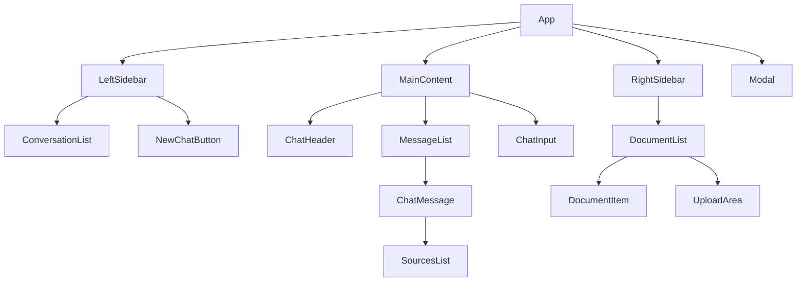
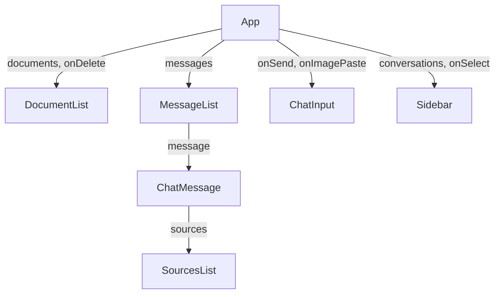
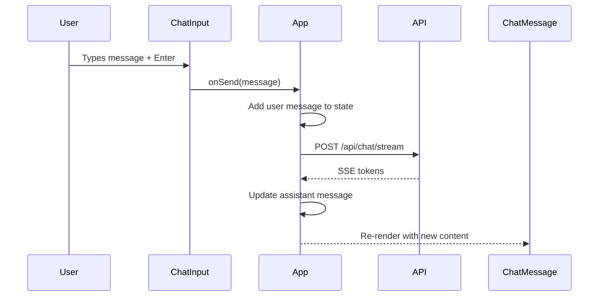

# Frontend Components

Detailed documentation for each React component in the frontend.

## Component Hierarchy



---

## App.tsx

The main container component that manages global state and orchestrates child components.

### Responsibilities

- Global state management (messages, documents, conversations)
- API communication
- Event handling
- Layout composition

### Key State

```typescript
interface AppState {
  messages: Message[];
  documents: DocumentInfo[];
  conversations: Conversation[];
  selectedDocIds: Set<string>;
  conversationId: string | null;
  isStreaming: boolean;
  isLoading: boolean;
  useStreaming: boolean;
}
```

### Event Handlers

| Handler                    | Purpose                                 |
| -------------------------- | --------------------------------------- |
| `handleSendMessage`        | Send user message, trigger AI response  |
| `handleFileUpload`         | Upload document to backend              |
| `handleDeleteDocument`     | Remove document from system             |
| `handleSelectConversation` | Load conversation history               |
| `handleNewConversation`    | Start fresh chat                        |
| `handleToggleDocSelection` | Select/deselect documents for filtering |

---

## ChatInput.tsx

Text input component with support for multi-line input and image paste.

### Props

```typescript
interface ChatInputProps {
  onSend: (message: string, additionalDocIds?: string[]) => void;
  onImagePaste: (file: File) => Promise<string | undefined>;
  disabled?: boolean;
  isUploading?: boolean;
}
```

### Features

- **Multi-line input**: Shift+Enter for new line
- **Submit on Enter**: Send message
- **Image paste**: Ctrl+V to paste clipboard images
- **Upload indicator**: Shows when image is being uploaded

### Implementation Highlights

```tsx
const handleKeyDown = (e: React.KeyboardEvent) => {
  if (e.key === "Enter" && !e.shiftKey) {
    e.preventDefault();
    handleSubmit();
  }
};

const handlePaste = async (e: React.ClipboardEvent) => {
  const items = e.clipboardData.items;
  for (const item of items) {
    if (item.type.startsWith("image/")) {
      e.preventDefault();
      const file = item.getAsFile();
      if (file) {
        const docId = await onImagePaste(file);
        // Store docId to include in next message
      }
    }
  }
};
```

---

## ChatMessage.tsx

Displays individual chat messages with role-specific styling.

### Props

```typescript
interface ChatMessageProps {
  message: Message;
  isStreaming?: boolean;
}

interface Message {
  id: string;
  role: "user" | "assistant";
  content: string;
  timestamp: Date;
  sources?: SourceDocument[];
}
```

### Styling

| Role      | Style                          |
| --------- | ------------------------------ |
| User      | Blue background, right-aligned |
| Assistant | Dark background, left-aligned  |

### Features

- Markdown rendering for AI responses
- Expandable source documents
- Timestamp display
- Streaming cursor animation

---

## SourcesList.tsx

Collapsible list showing source documents used to generate a response.

### Props

```typescript
interface SourcesListProps {
  sources: SourceDocument[];
}

interface SourceDocument {
  filename: string;
  content: string;
}
```

### UI

```
┌─────────────────────────────────┐
│ ▼ 4 sources                     │
├─────────────────────────────────┤
│ 📄 document1.pdf                │
│ "Retrieved content preview..."  │
├─────────────────────────────────┤
│ 📄 document2.docx               │
│ "Another content preview..."    │
└─────────────────────────────────┘
```

---

## DocumentList.tsx

Right sidebar component for document management.

### Props

```typescript
interface DocumentListProps {
  documents: DocumentInfo[];
  selectedIds: Set<string>;
  onToggleSelect: (id: string) => void;
  onDelete: (id: string) => void;
  onUpload: (file: File) => Promise<void>;
  isUploading: boolean;
}
```

### Features

- **Select All / Deselect All**: Quick selection toggles
- **Drag & Drop**: Drop files onto the upload area
- **Document Preview**: Show filename, size, chunk count
- **Delete with Confirmation**: Modal confirmation before delete

### Supported File Types Display

```tsx
const fileTypes = ["PDF", "Word", "Excel", "PPT", "TXT/MD", "HTML", "Image"];

<div className="flex flex-wrap gap-1">
  {fileTypes.map((type) => (
    <span key={type} className="px-2 py-0.5 bg-gray-700 rounded text-xs">
      {type}
    </span>
  ))}
</div>;
```

---

## Sidebar.tsx (Left)

Conversation history sidebar.

### Props

```typescript
interface SidebarProps {
  conversations: Conversation[];
  activeId: string | null;
  onSelect: (id: string) => void;
  onNew: () => void;
  onDelete: (id: string) => void;
}
```

### Features

- New chat button
- Conversation list with titles
- Message count and timestamp
- Delete conversation with confirmation

---

## Modal.tsx

Reusable modal dialog component.

### Props

```typescript
interface ModalProps {
  open: boolean;
  onClose: () => void;
  title: string;
  children: React.ReactNode;
  actions?: React.ReactNode;
}
```

### Usage

```tsx
<Modal
  open={showDeleteModal}
  onClose={() => setShowDeleteModal(false)}
  title="Delete Document"
  actions={
    <>
      <Button onClick={handleCancel}>Cancel</Button>
      <Button variant="danger" onClick={handleConfirm}>
        Delete
      </Button>
    </>
  }
>
  <p>Are you sure you want to delete this document?</p>
</Modal>
```

---

## Component Communication

### Props Drilling Pattern



### Event Flow



---

## Styling Patterns

### Tailwind Classes

```tsx
// Common patterns used throughout

// Card/Panel
className="bg-gray-800 rounded-lg p-4 border border-gray-700"

// Button Primary
className="px-4 py-2 bg-blue-600 hover:bg-blue-700 text-white rounded-lg
           transition-colors disabled:opacity-50"

// Button Danger
className="px-4 py-2 bg-red-600 hover:bg-red-700 text-white rounded-lg"

// Input Field
className="w-full bg-gray-700 text-white rounded-lg px-4 py-2
           focus:outline-none focus:ring-2 focus:ring-blue-500"

// Scrollable Container
className="flex-1 overflow-y-auto"
```

### Responsive Design

```tsx
// Sidebar widths
<div className="w-64 hidden md:block">  {/* Desktop only */}
<div className="w-full md:w-80">        {/* Full on mobile, fixed on desktop */}

// Chat container
<div className="flex flex-col h-screen md:flex-row">
```

---

## Accessibility

| Feature             | Implementation                   |
| ------------------- | -------------------------------- |
| Keyboard navigation | Tab through interactive elements |
| Focus management    | Auto-focus input after actions   |
| ARIA labels         | Screen reader support            |
| Color contrast      | WCAG AA compliant colors         |

```tsx
<button aria-label="Delete document" onClick={handleDelete} className="...">
  <TrashIcon />
</button>
```
