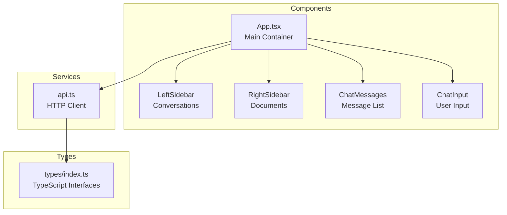

# Frontend Overview

The frontend is a modern React application built with TypeScript, providing a responsive chat interface for document Q&A.

## Tech Stack

| Technology   | Purpose                 |
| ------------ | ----------------------- |
| React 18     | UI library with hooks   |
| TypeScript   | Type safety             |
| Vite         | Build tool & dev server |
| Tailwind CSS | Utility-first styling   |

## Architecture



## Directory Structure

```
frontend/
├── src/
│   ├── components/
│   │   ├── ChatInput.tsx       # Message input with paste support
│   │   ├── ChatMessage.tsx     # Individual message display
│   │   ├── DocumentList.tsx    # Document management panel
│   │   ├── Sidebar.tsx         # Conversation sidebar
│   │   ├── Modal.tsx           # Reusable modal component
│   │   └── SourcesList.tsx     # Source document display
│   ├── services/
│   │   └── api.ts              # Backend API client
│   ├── types/
│   │   └── index.ts            # TypeScript type definitions
│   ├── App.tsx                 # Main application component
│   ├── main.tsx                # Application entry point
│   └── index.css               # Global styles (Tailwind)
├── public/
│   └── favicon.ico
├── index.html
├── package.json
├── tsconfig.json
├── tailwind.config.js
└── vite.config.ts
```

## Key Features

### 1. Dual Sidebar Layout

```
┌─────────────────────────────────────────────────────────────┐
│  LeftSidebar  │      Chat Area        │   RightSidebar     │
│               │                       │                     │
│  Conversations│   Messages            │   Documents         │
│  - Chat 1     │   ┌─────────────┐    │   ☑ doc1.pdf       │
│  - Chat 2     │   │ User msg    │    │   ☑ doc2.docx      │
│  - Chat 3     │   │ AI response │    │   ☐ doc3.txt       │
│               │   └─────────────┘    │                     │
│               │                       │   [Upload Area]     │
│               │   [Input box    ]    │                     │
└─────────────────────────────────────────────────────────────┘
```

### 2. Streaming Responses

Real-time token display as the AI generates responses.

### 3. Document Selection

Filter AI responses to only selected documents.

### 4. Image Paste

Ctrl+V to paste images directly for OCR processing.

### 5. Drag & Drop Upload

Drop files anywhere on the chat area to upload.

## State Management

React hooks manage application state:

```typescript
// Core state in App.tsx
const [messages, setMessages] = useState<Message[]>([]);
const [documents, setDocuments] = useState<DocumentInfo[]>([]);
const [conversations, setConversations] = useState<Conversation[]>([]);
const [selectedDocIds, setSelectedDocIds] = useState<Set<string>>(new Set());
const [conversationId, setConversationId] = useState<string | null>(null);
const [isStreaming, setIsStreaming] = useState(false);
const [isLoading, setIsLoading] = useState(false);
```

## Running the Frontend

```bash
cd frontend

# Install dependencies
npm install

# Start development server
npm run dev

# Build for production
npm run build
```

Development server runs at `http://localhost:5173`

## Next Steps

- [Components](components.md) - Detailed component documentation
- [State Management](state-management.md) - How state flows through the app
