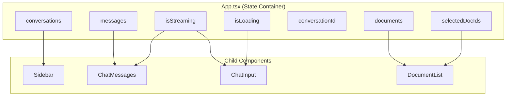
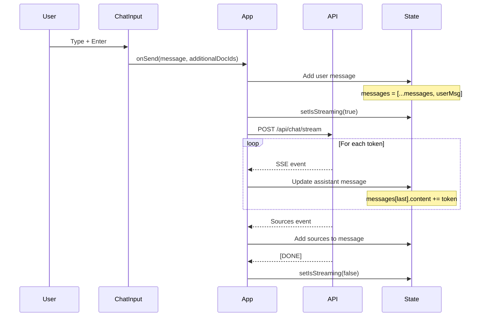
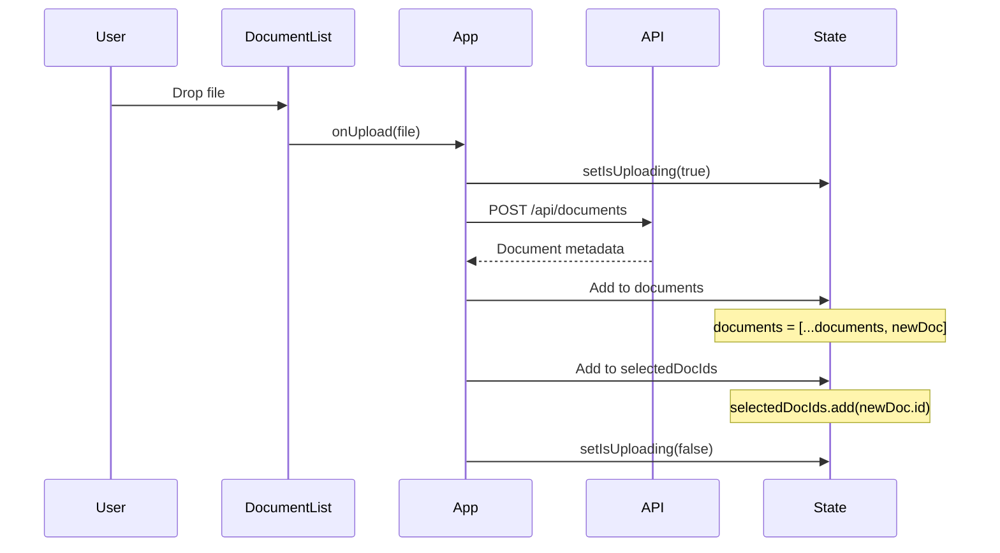
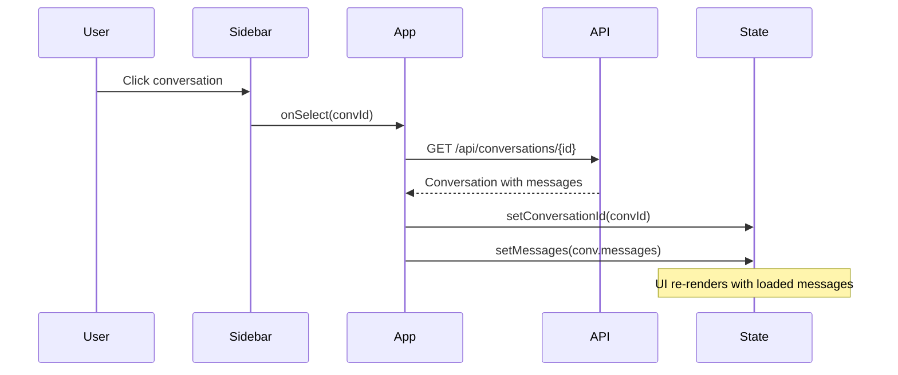

# State Management

This document explains how state flows through the React frontend application.

## State Architecture

The application uses React's built-in state management (useState, useEffect, useRef) without external libraries like Redux.



## State Definitions

### Messages State

```typescript
interface Message {
  id: string;
  role: "user" | "assistant";
  content: string;
  timestamp: Date;
  sources?: SourceDocument[];
}

const [messages, setMessages] = useState<Message[]>([]);
```

**Used by:** ChatMessages, for displaying conversation

**Updated by:**

- `handleSendMessage` - Adds user message
- `handleStreamingMessage` - Updates assistant message during streaming
- `handleNonStreamingMessage` - Adds complete assistant message
- `handleSelectConversation` - Loads conversation history

### Documents State

```typescript
interface DocumentInfo {
  id: string;
  filename: string;
  content_type: string;
  size: number;
  chunk_count: number;
  uploaded_at: string;
}

const [documents, setDocuments] = useState<DocumentInfo[]>([]);
```

**Used by:** DocumentList, RightSidebar

**Updated by:**

- `fetchDocuments` - Load from API on mount
- `handleUploadSuccess` - Add newly uploaded document
- `handleDeleteDocument` - Remove deleted document

### Conversations State

```typescript
interface Conversation {
  id: string;
  title: string;
  created_at: string;
  updated_at: string;
  message_count: number;
}

const [conversations, setConversations] = useState<Conversation[]>([]);
```

**Used by:** Sidebar (LeftSidebar)

**Updated by:**

- `fetchConversations` - Load from API on mount
- API response after sending message - Includes new conversation ID

### Selected Documents State

```typescript
const [selectedDocIds, setSelectedDocIds] = useState<Set<string>>(new Set());
```

**Purpose:** Filter RAG queries to only selected documents

**Used by:** DocumentList (checkboxes), chat API calls

**Updated by:**

- `handleToggleDocSelection` - Toggle individual document
- `handleSelectAll` / `handleDeselectAll` - Bulk selection
- `handleUploadSuccess` - Auto-select newly uploaded docs

### UI State

```typescript
const [isStreaming, setIsStreaming] = useState(false);
const [isLoading, setIsLoading] = useState(false);
const [isUploading, setIsUploading] = useState(false);
const [conversationId, setConversationId] = useState<string | null>(null);
const [useStreaming, setUseStreaming] = useState(true);
```

## State Flow Diagrams

### Sending a Message



### Uploading a Document



### Selecting a Conversation



## Derived State

Some values are computed from state rather than stored:

```typescript
// Document count for header
const selectedCount = selectedDocIds.size;
const totalCount = documents.length;

// Whether to show loading indicator
const showLoading = isLoading || isStreaming;

// Filtered documents (if search was implemented)
const filteredDocs = documents.filter((d) =>
  d.filename.toLowerCase().includes(searchQuery.toLowerCase()),
);
```

## Refs for Non-Reactive Data

Refs store values that shouldn't trigger re-renders:

```typescript
// Accumulate streamed content without re-rendering on each token
const streamingContentRef = useRef<string>("");

// Track current conversation for async operations
const currentConversationRef = useRef<string | null>(null);

// Auto-scroll chat container
const messagesEndRef = useRef<HTMLDivElement>(null);
```

## Effects

### On Mount - Load Initial Data

```typescript
useEffect(() => {
  const loadInitialData = async () => {
    await Promise.all([fetchDocuments(), fetchConversations()]);
  };
  loadInitialData();
}, []);
```

### Auto-Scroll on New Messages

```typescript
useEffect(() => {
  messagesEndRef.current?.scrollIntoView({ behavior: "smooth" });
}, [messages]);
```

### Sync Selected Documents When Documents Change

```typescript
useEffect(() => {
  // Remove selected IDs for deleted documents
  setSelectedDocIds((prev) => {
    const validIds = new Set<string>();
    prev.forEach((id) => {
      if (documents.some((d) => d.id === id)) {
        validIds.add(id);
      }
    });
    return validIds;
  });
}, [documents]);
```

## State Update Patterns

### Optimistic Updates

Update UI immediately, rollback on error:

```typescript
const handleDeleteDocument = async (id: string) => {
  // Optimistic: Remove from UI immediately
  const previousDocs = documents;
  setDocuments((docs) => docs.filter((d) => d.id !== id));

  try {
    await api.deleteDocument(id);
  } catch (error) {
    // Rollback on failure
    setDocuments(previousDocs);
    showError("Failed to delete document");
  }
};
```

### Immutable Updates

Always create new arrays/objects:

```typescript
// Adding to array
setMessages((prev) => [...prev, newMessage]);

// Updating item in array
setMessages((prev) =>
  prev.map((msg) =>
    msg.id === targetId ? { ...msg, content: newContent } : msg,
  ),
);

// Removing from array
setDocuments((prev) => prev.filter((doc) => doc.id !== targetId));

// Updating Set
setSelectedDocIds((prev) => {
  const next = new Set(prev);
  next.add(newId);
  return next;
});
```

### Batched Updates

React automatically batches state updates in event handlers:

```typescript
const handleNewConversation = () => {
  // These updates are batched into a single render
  setConversationId(null);
  setMessages([]);
  setSelectedDocIds(new Set(documents.map((d) => d.id)));
};
```

## Performance Considerations

### Memoization

```typescript
// Memoize expensive computations
const sortedConversations = useMemo(
  () =>
    [...conversations].sort(
      (a, b) =>
        new Date(b.updated_at).getTime() - new Date(a.updated_at).getTime(),
    ),
  [conversations],
);

// Memoize callbacks passed to children
const handleToggleDoc = useCallback((id: string) => {
  setSelectedDocIds((prev) => {
    const next = new Set(prev);
    if (next.has(id)) {
      next.delete(id);
    } else {
      next.add(id);
    }
    return next;
  });
}, []);
```

### Avoiding Unnecessary Renders

```typescript
// Use React.memo for pure components
const ChatMessage = React.memo(({ message }: Props) => {
  // Only re-renders if message changes
  return <div>{message.content}</div>;
});

// Split state to minimize re-render scope
// Instead of one big state object, use multiple useState calls
const [messages, setMessages] = useState([]);
const [documents, setDocuments] = useState([]);
// Changes to documents won't re-render message-related components
```
