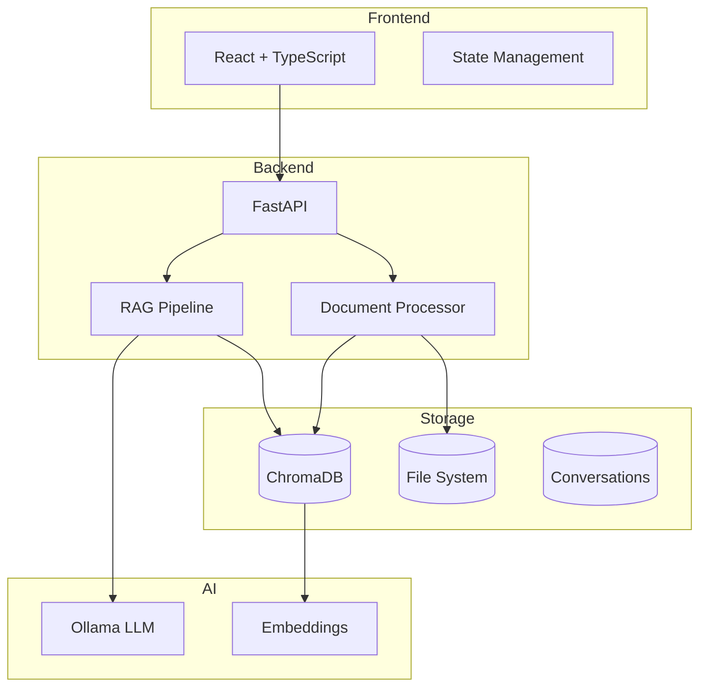

# RAG Document Q&A

A full-stack **Retrieval-Augmented Generation (RAG)** application that allows users to upload documents and ask questions about them using natural language.

!!! tip "New to RAG?"
Check out our [What is RAG?](rag-case-study.md) case study for a comprehensive introduction to Retrieval-Augmented Generation.

## How It Works

The RAG pipeline has two main phases: **Ingestion** (indexing documents) and **Query** (answering questions).

=== "📥 Document Ingestion"

    ```mermaid
    flowchart TD
        A[📄 Upload Document] --> B[Extract Text]
        B --> C[Split into Chunks]
        C --> D[Generate Embeddings]
        D --> E[(Store in Vector DB)]

        style A fill:#4CAF50,color:#fff
        style E fill:#2196F3,color:#fff
    ```

    **Supported formats:** PDF, Word, Excel, PowerPoint, Images (OCR), Text, Markdown, HTML

=== "💬 Question Answering"

    ```mermaid
    flowchart TD
        Q[❓ User Question] --> S[Generate Query Embedding]
        S --> R[Search Vector DB]
        R --> C[Retrieve Top Chunks]
        C --> P[Build Prompt with Context]
        P --> L[🤖 LLM Generates Answer]
        L --> A[✅ Answer + Source Citations]

        style Q fill:#9C27B0,color:#fff
        style A fill:#4CAF50,color:#fff
    ```

    **Key features:** Semantic search, source attribution, conversation memory

## Key Features

|                                                                         |                                                                         |
| :---------------------------------------------------------------------- | :---------------------------------------------------------------------- |
| :material-file-document-multiple: **Multi-Format Support**              | :material-robot: **AI-Powered Q&A**                                     |
| Upload PDFs, Word docs, Excel, PowerPoint, images, and text files       | Ask questions in natural language and get accurate answers with sources |
| :material-history: **Conversation Memory**                              | :material-image-search: **Image OCR**                                   |
| Maintain context across multiple questions with persistent chat history | Extract and search text from images using optical character recognition |
| :material-filter: **Context Filtering**                                 | :material-lightning-bolt: **Streaming Responses**                       |
| Select which documents to include as context for more focused answers   | Watch AI responses appear in real-time as they're generated             |

## Quick Start

```bash
# Clone the repository
git clone https://github.com/yourusername/rag-research.git
cd rag-research

# Start the backend
cd backend
uv venv && source .venv/bin/activate
uv pip install -r requirements.txt
uvicorn app.main:app --reload

# Start the frontend (new terminal)
cd frontend
npm install && npm run dev
```

Open [http://localhost:5173](http://localhost:5173) to use the application.

## Features

| Feature               | Description                                         |
| --------------------- | --------------------------------------------------- |
| 📄 Document Upload    | Drag-and-drop or browse to upload documents         |
| 🔍 Semantic Search    | Find relevant content using AI-powered embeddings   |
| 💬 Chat Interface     | Natural conversation with streaming responses       |
| 📋 Document Selection | Filter answers to specific documents                |
| 🖼️ Image Paste        | Paste images directly (Ctrl+V) for OCR processing   |
| 💾 Persistence        | Conversations and documents persist across sessions |

## Architecture Overview



## Documentation Sections

- **[Architecture](architecture/overview.md)** - System design, tech stack, and design patterns
- **[Backend](backend/overview.md)** - FastAPI server, document processing, and RAG pipeline
- **[Frontend](frontend/overview.md)** - React components and state management
- **[API Reference](api/overview.md)** - Complete API documentation
- **[Deployment](deployment/local-setup.md)** - Setup and deployment guides

## Tech Stack at a Glance

| Layer           | Technology            | Purpose                         |
| --------------- | --------------------- | ------------------------------- |
| Frontend        | React 18 + TypeScript | Modern, type-safe UI            |
| Styling         | Tailwind CSS          | Utility-first CSS framework     |
| Backend         | FastAPI (Python 3.9+) | High-performance async API      |
| RAG Framework   | LangChain             | Document processing & retrieval |
| Vector Database | ChromaDB              | Store & query embeddings        |
| LLM             | Ollama (llama3.2)     | Local AI model inference        |
| Embeddings      | nomic-embed-text      | Document vectorization          |
