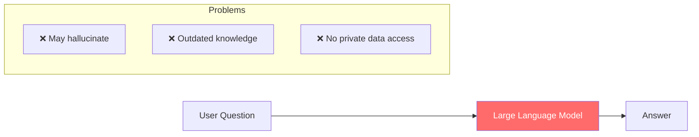
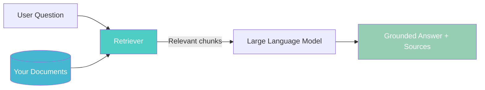
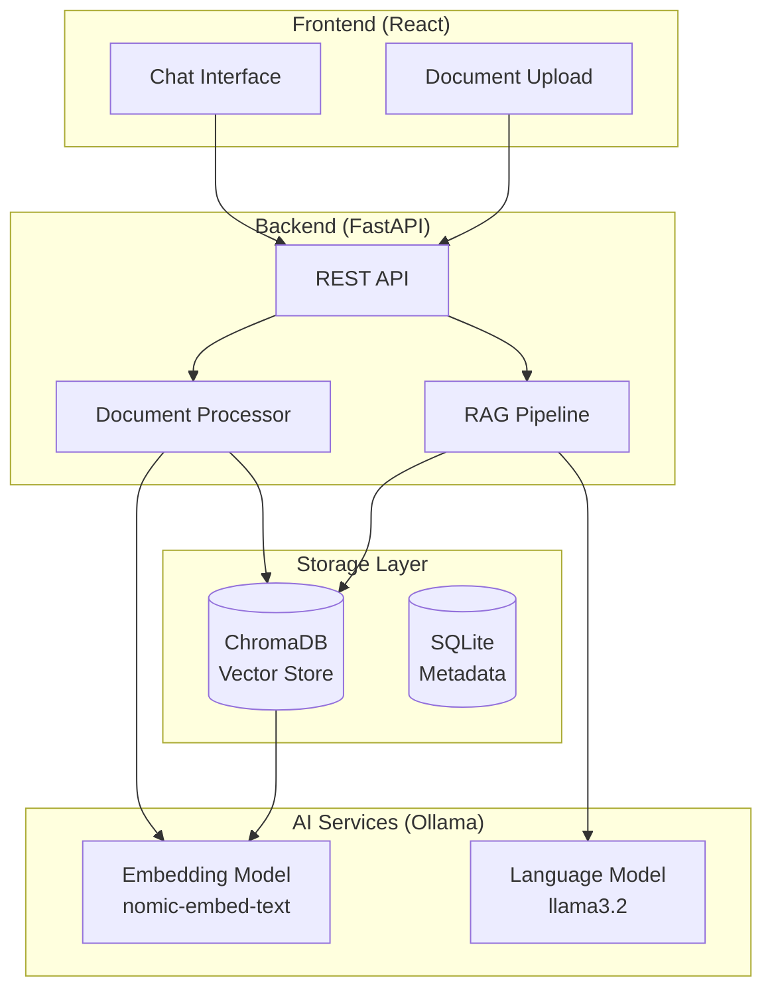
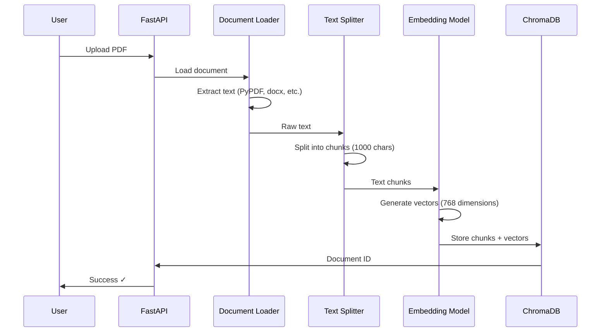
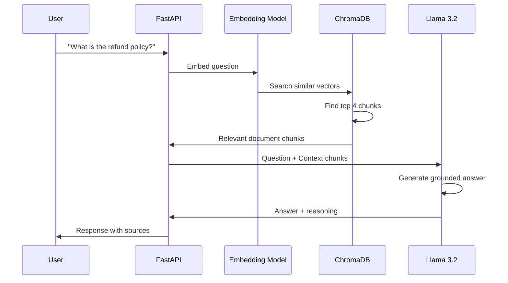
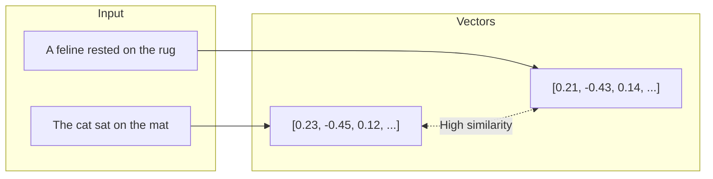
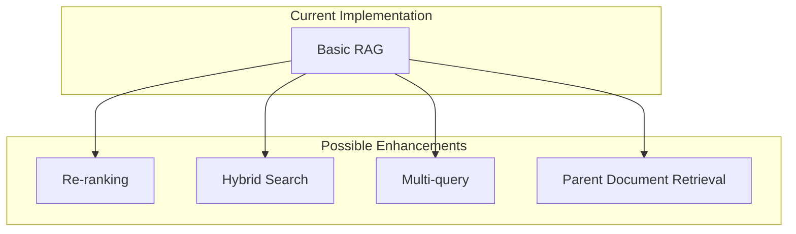
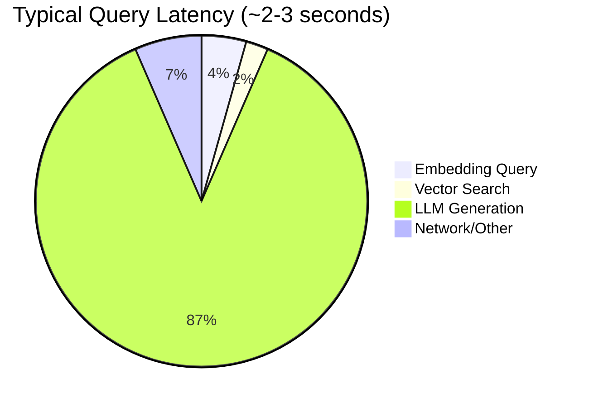
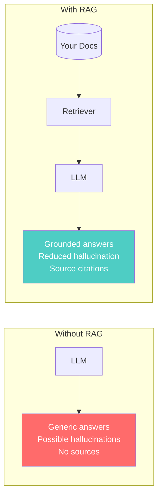

# What is RAG? A Case Study

## Introduction

**Retrieval-Augmented Generation (RAG)** is a technique that enhances Large Language Models (LLMs) by grounding their responses in your own documents and data. Instead of relying solely on the model's training data, RAG retrieves relevant information from your knowledge base and uses it as context for generating accurate, source-backed answers.

!!! info "Why RAG Matters"
LLMs are powerful but have limitations: they can hallucinate facts, lack knowledge of your private data, and their training data has a cutoff date. RAG solves these problems by giving the LLM real-time access to your documents.

---

## The Problem RAG Solves

### Traditional LLM Limitations



| Problem              | Description                                                     | Impact                           |
| -------------------- | --------------------------------------------------------------- | -------------------------------- |
| **Hallucination**    | LLMs confidently generate plausible but incorrect information   | Unreliable answers               |
| **Knowledge Cutoff** | Training data has a fixed date                                  | Can't answer about recent events |
| **No Private Data**  | LLMs don't know your documents, policies, or internal knowledge | Generic responses only           |

### The RAG Solution



RAG addresses all three limitations:

- ✅ **Reduces hallucination** - Answers are grounded in actual documents
- ✅ **Always current** - Your documents can be updated anytime
- ✅ **Private knowledge** - Works with your internal data

---

## Case Study: Document Q&A Application

This RAG Q&A application demonstrates a production-ready RAG implementation. Let's walk through how it works.

### Architecture Overview



### The RAG Pipeline: Step by Step

#### Phase 1: Document Ingestion

When a user uploads a document, here's what happens:



**Key Concepts:**

| Step          | What Happens                                   | Why It Matters                          |
| ------------- | ---------------------------------------------- | --------------------------------------- |
| **Loading**   | Extract text from PDF, Word, Excel, images     | Supports multiple formats               |
| **Chunking**  | Split into ~1000 character pieces with overlap | Fits context windows, preserves meaning |
| **Embedding** | Convert text to 768-dimensional vectors        | Enables semantic search                 |
| **Storage**   | Save vectors + metadata in ChromaDB            | Fast similarity search                  |

#### Phase 2: Question Answering

When a user asks a question:



**The Magic of Semantic Search:**

```python
# Traditional keyword search
query = "refund policy"
# ❌ Misses: "return items", "money back guarantee", "cancellation terms"

# Semantic vector search
query_vector = embed("refund policy")  # [0.23, -0.45, 0.12, ...]
# ✅ Finds semantically similar content regardless of exact words
```

---

## Real Example: How It Works

### User Query

> "What are the key findings from the Q3 report?"

### Step 1: Embed the Query

The question is converted to a vector representation that captures its meaning.

### Step 2: Retrieve Relevant Chunks

ChromaDB finds the most similar document chunks:

```
Chunk 1 (similarity: 0.89): "Q3 2024 showed a 15% increase in revenue..."
Chunk 2 (similarity: 0.85): "Key performance indicators for Q3 include..."
Chunk 3 (similarity: 0.82): "The third quarter results demonstrate..."
Chunk 4 (similarity: 0.78): "Financial highlights: Revenue grew to..."
```

### Step 3: Generate Response

The LLM receives the question + retrieved context:

```
System: You are a helpful assistant. Answer based on the provided context.

Context:
[Chunk 1] Q3 2024 showed a 15% increase in revenue...
[Chunk 2] Key performance indicators for Q3 include...
[Chunk 3] The third quarter results demonstrate...
[Chunk 4] Financial highlights: Revenue grew to...

Question: What are the key findings from the Q3 report?
```

### Step 4: Return Grounded Answer

> **Answer:** Based on the Q3 report, the key findings include:
>
> 1. Revenue increased by 15% compared to the previous quarter
> 2. Key performance indicators showed positive trends...
>
> **Sources:** Q3_Report.pdf (pages 3, 7, 12)

---

## Key RAG Components Explained

### 1. Vector Embeddings

Embeddings are numerical representations of text that capture semantic meaning.



!!! tip "Why Embeddings Work"
Even though "cat/feline" and "mat/rug" are different words, their embeddings are similar because they have similar meanings. This enables semantic search.

### 2. Vector Database (ChromaDB)

ChromaDB stores embeddings and performs fast similarity search.

```python
# How similarity search works
collection.query(
    query_embeddings=[question_vector],
    n_results=4,  # Top 4 most similar
    where={"document_id": {"$in": selected_doc_ids}}  # Filter by docs
)
```

**Why ChromaDB?**

- 🚀 Fast approximate nearest neighbor search
- 🔍 Metadata filtering support
- 💾 Persistent storage
- 🐍 Python-native integration

### 3. Text Splitting Strategy

Documents are split into overlapping chunks to preserve context:

```
Original Document (3000 chars):
[========================================]

After Splitting (chunk_size=1000, overlap=200):
[Chunk 1: 1000 chars    ]
          [Chunk 2: 1000 chars    ]
                    [Chunk 3: 1000 chars    ]
          ↑ 200 char overlap
```

!!! warning "Chunk Size Trade-offs" - **Too small:** Loses context, fragments ideas - **Too large:** Dilutes relevance, wastes context window - **Sweet spot:** 500-1500 characters with 10-20% overlap

### 4. Retrieval Strategy

This application uses **similarity search with filtering**:

```python
# Retrieve top-k most relevant chunks
retriever = vectorstore.as_retriever(
    search_type="similarity",
    search_kwargs={
        "k": 4,  # Number of chunks
        "filter": {"document_id": {"$in": doc_ids}}  # User-selected docs
    }
)
```

---

## RAG vs. Fine-Tuning vs. Prompt Engineering

| Approach               | Best For                          | Pros                                              | Cons                              |
| ---------------------- | --------------------------------- | ------------------------------------------------- | --------------------------------- |
| **RAG**                | Dynamic knowledge, document Q&A   | No training needed, always current, cites sources | Requires retrieval infrastructure |
| **Fine-Tuning**        | Consistent style/behavior changes | Baked-in knowledge, fast inference                | Expensive, static, no sources     |
| **Prompt Engineering** | Simple customization              | Quick, no infrastructure                          | Limited by context window         |

!!! success "When to Use RAG" - ✅ You have documents users need to query - ✅ Information changes frequently - ✅ You need source attribution - ✅ You can't afford fine-tuning - ✅ Privacy matters (data stays local)

---

## Advanced RAG Techniques

This application implements several RAG best practices:

### Implemented Features

| Feature                  | Description                   | Benefit                            |
| ------------------------ | ----------------------------- | ---------------------------------- |
| **Multi-format support** | PDF, Word, Excel, PPT, images | Handle any document type           |
| **OCR integration**      | Extract text from images      | Process screenshots, scanned docs  |
| **Conversation memory**  | Track chat history            | Follow-up questions work naturally |
| **Document filtering**   | Select which docs to query    | More focused, relevant answers     |
| **Streaming responses**  | Real-time token output        | Better user experience             |
| **Source citations**     | Show which chunks were used   | Verify and explore answers         |

### Potential Enhancements



---

## Performance Considerations

### Latency Breakdown



### Optimization Strategies

1. **Streaming** - Show tokens as they generate (implemented ✓)
2. **Caching** - Cache frequent query embeddings
3. **Batch processing** - Embed documents in batches
4. **GPU acceleration** - Faster embedding and generation

---

## Summary

RAG transforms LLMs from general-purpose assistants into domain experts on your documents:



### Key Takeaways

1. **RAG = Retrieval + Generation** - Find relevant info, then generate answers
2. **Vectors enable semantic search** - Match meaning, not just keywords
3. **Chunking matters** - Balance context preservation vs. relevance
4. **Sources build trust** - Users can verify and explore
5. **Local LLMs work** - Privacy-preserving RAG is achievable

---

## Try It Yourself

1. Upload some documents using the panel on the right
2. Select which documents to include as context
3. Ask a question about your documents
4. Expand the sources to see which chunks were used
5. Notice how answers are grounded in your actual content

!!! quote "The Goal of RAG"
"Give LLMs access to the right information at the right time, so they can give accurate, verifiable answers."
